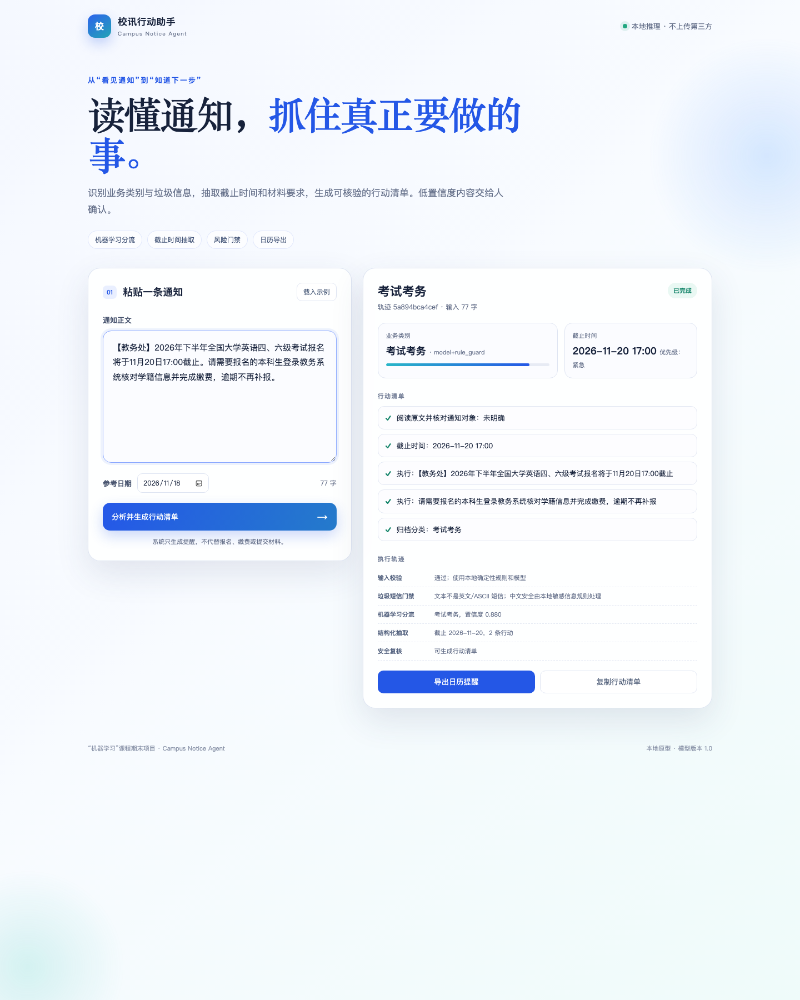

# 校讯行动助手（Campus Notice Action Agent）

一个可本地运行的机器学习 Agent 原型：把中文校园通知转换为带截止时间、材料清单和
待办事项的结构化结果；对英文垃圾短信在生成行动前进行拦截；信息不完整或置信度不足时
要求人工确认，不自动报名、缴费或提交材料。



## 功能

- 7 类中文校园通知路由：学籍事务、课程辅修、考试考务、毕业创新、竞赛活动、
  升学选拔、校务公告。
- 中文字符 TF-IDF + 逻辑回归，并针对时间漂移增加显式业务词保护规则。
- 规则抽取截止日期、时间、行动句、材料、适用对象与安全风险。
- UCI SMS Spam Collection 训练的词级/字符级 TF-IDF + 逻辑回归垃圾短信门禁。
- 支持粘贴文本、`.txt`、`.docx`、`.pdf` 输入，以及 `.ics` 日历和 Markdown 清单输出。
- 本地网页界面、命令行、自动测试、模型指标和完整实验复现脚本。

## 目录

```text
data/raw/            教务处公开通知的标题、日期、链接和正文摘录
data/processed/      去重后的 118 条分类语料、20 条手写边界案例
data/external/       UCI SMS Spam Collection v.1（CC BY 4.0）
src/notice_agent/    分类、抽取、文件安全、Agent、CLI、网页服务
scripts/             数据构建、训练、评估、延迟测试
web/                 无外部前端依赖的本地单页原型
artifacts/           模型、图表、评测报告
tests/               端到端、时间抽取、垃圾拦截和 DOCX 安全测试
```

## 环境

推荐 Python 3.10，已在 macOS 15.3.1 / Python 3.10.20 验证。

```bash
cd campus_notice_agent
python3.10 -m venv .venv
source .venv/bin/activate
python -m pip install -r requirements.txt
```

## 直接运行

仓库中已包含训练好的两个模型，可直接启动网页：

```bash
PYTHONPATH=src python -m notice_agent.server --port 8765
```

打开 <http://127.0.0.1:8765>。点击“载入示例”后即可分析。

命令行示例：

```bash
PYTHONPATH=src python -m notice_agent.cli \
  --text "关于微专业退改选的通知：请在11月6日前登录系统完成退改选。" \
  --date 2026-11-04 \
  --output-dir artifacts/demo/cli
```

文件输入：

```bash
PYTHONPATH=src python -m notice_agent.cli --file notice.docx --date 2026-11-18
```

## 从数据到结果复现

```bash
python scripts/fetch_notices.py       # 公开页面，请求间隔 0.2 s
python scripts/build_dataset.py       # 去重与分类标签
python scripts/fetch_sms_dataset.py   # 下载并校验 UCI SMS 语料
PYTHONPATH=src python scripts/train_models.py
python scripts/train_spam_model.py
PYTHONPATH=src python scripts/evaluate_agent.py
PYTHONPATH=src python scripts/benchmark_agent.py
PYTHONPATH=src python -m unittest discover -s tests -v
```

## 主要结果

中文通知分类使用 2025-01-01 作为时间切分：77 条较早通知训练，41 条较新通知测试。
纯机器学习模型的测试准确率为 0.659、宏平均 F1 为 0.641；该结果暴露出“升学选拔”
类别在训练期完全缺失以及标题漂移。加入显式业务词保护后，时间外推测试准确率与宏平均
F1 均为 1.000，但这是一项受词典覆盖影响的结果，不能视为独立泛化估计。较早通知上的
分层 5 折交叉验证中，标题+正文逻辑回归的准确率为 0.935、宏平均 F1 为 0.900。

垃圾短信实验先删除完全重复消息（5574 → 5171），再按 8:2 分层划分。独立测试集
1035 条上的准确率为 0.985，宏平均 F1 为 0.965，垃圾类 Precision 为 0.946、
Recall 为 0.931、ROC-AUC 为 0.996。

20 条未参与训练的手写边界案例中，截止日期精确准确率为 1.000（14 条有日期案例），
人工复核决策准确率为 1.000，未出现该复核却自动通过的情况；端到端任务成功率为
0.950。单条中文通知的本地热启动推理中位延迟约为 0.50 ms（60 次运行）。

## 安全与边界

- 文件最大 5 MB；DOCX 限制 2000 个条目和 30 MB 解压体积，拒绝路径穿越与活动内容。
- 用户文本只在本机处理，不上传第三方 API，日志不记录正文。
- 低置信度、时间待定、无截止日期或敏感信息索取会触发人工复核。
- 系统不自动执行报名、付款、提交、登录等外部状态变更。
- 中文通知语料规模较小，类别不均衡，公开页面附件并不总能被正文抓取。
- 垃圾短信模型是英文旧短信语料，不能直接代表中文钓鱼短信效果。
- 模型输出只用于个人提醒与信息整理，不作为学籍、考试或处分决定的依据。

## 来源与许可

- 中文通知：上海工程技术大学教务处公开“通知公告（学生）”页面，仅保留公开标题、
  日期、链接和短正文摘录；访问日期 2026-11-18。用于课程研究，不收集登录后数据。
- 短信语料：UCI SMS Spam Collection v.1，CC BY 4.0，
  DOI <https://doi.org/10.24432/C5CC84>。
- `docx` skill：Anthropic Agent Skills 仓库，提交
  `e4bb5d960d87126ff3b3a8af1a104b7db67560ba`，Apache-2.0。项目仅复用其
  “先验证不受信任文档再解析”的指导，并独立实现验证逻辑。详见
  [THIRD_PARTY_NOTICES.md](THIRD_PARTY_NOTICES.md)。

本项目的运行时不需要大语言模型或 API 密钥。生成式 AI 用于辅助代码起草、调试和
报告组织；所有数值由仓库脚本重新计算，详见报告“生成式 AI 使用说明”。

公开代码仓库不附带含姓名、电话等内容的网页正文快照，也不附带报告原件；复现时运行
抓取脚本重新获取公开数据。仓库声明、许可和隐私边界见
[DECLARATION.md](DECLARATION.md)。
